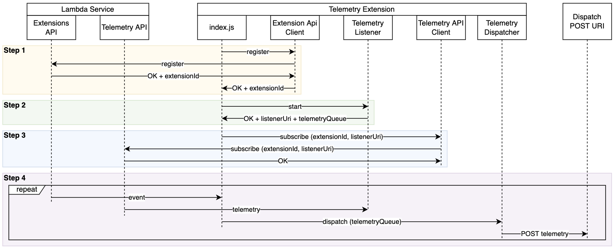

# Example Telemetry API Extension in Nodejs

The provided code sample demonstrates how to get a basic Telemetry API extension written in Nodejs up and running.

> This is a simple example extension to help you start investigating the Lambda Telemetry API. This example code is not production ready. Use it with your own discretion after testing thoroughly.

This sample extension: 
1. Registers the extension with Lambda Extensions API (see `nodejs-example-telemetry-api-extension/extensions-api.js`)
2. Starts a local HTTP server to receive incoming telemetry events from the Telemetry API (see `nodejs-example-telemetry-api-extension/telemetry-listener.js`)
3. Subscribes to the Telemetry API to start receiving incoming telemetry events (see `nodejs-example-telemetry-api-extension/telemetry-api.js`)
4. Builds Embedded Metric Format (EMF) records from the received telemetry events and writes them to a dedicated CloudWatch Logs log group via the `PutLogEvents` API (see `nodejs-example-telemetry-api-extension/emf-logger.js`)



The log group destination is controlled by the `METRICS_LOG_GROUP` environment variable, defaulting to `/metrics/lambda-execution-lifecycle`. On the first write the extension creates a log stream in that group, then sends each EMF record with `PutLogEvents`. Depending on buffering configuration you pass to the Telemetry API during subscription, you might get either zero, one, or multiple requests from Telemetry API to the telemetry listener in a single function invocation. 

The code is heavily instrumented with logs so you'll be able to see the Telemetry API extension lifecycle messages as you're learning to implement one. 

## Build package and dependencies

There are two major components to this sample:

* `./extensions/` - This directory should be extracted to `/opt/extensions` where the Lambda platform will scan for executables to launch extensions
* `./nodejs-example-telemetry-api-extension/` - This directory should be extracted to `/opt/nodejs-example-telemetry-api-extension`, which is referenced by the `./extensions/nodejs-example-telemetry-api-extension` executable and includes a Nodejs executable along with all of its necessary dependencies.

Install the extension dependencies locally, which will be mounted along with the extension code.
```bash
cd nodejs-example-telemetry-api-extension
chmod +x index.js
npm install
cd ..
```

## Layer Setup Process
The extension .zip file should contain a root directory called `extensions/`, where the extension executables are located, and another root directory called `nodejs-example-telemetry-api-extensions/`, where the core logic of the extension and its dependencies are located. 

Creating zip package for the extension:

```bash
chmod +x extensions/nodejs-example-telemetry-api-extension
zip -r extension.zip ./nodejs-example-telemetry-api-extension
zip -r extension.zip ./extensions
```

Publish a new layer using the `extension.zip` using below command. The output should provide you with a layer ARN. 

```bash
aws lambda publish-layer-version \
    --layer-name "nodejs-example-telemetry-api-extension" \
    --zip-file  "fileb://extension.zip"
```

Note the `LayerVersionArn` that is produced in the output. eg. 

```
LayerVersionArn: arn:aws:lambda:<region>:123456789012:layer:<layerName>:1
```

Add the newly created layer version to a Node.js runtime Lambda function.

```bash
aws lambda update-function-configuration 
    --function-name <your function name> 
    --layers <layer arn>
```

## Function Invocation and Extension Execution

Configure the extension by setting below environment variables

* `METRICS_LOG_GROUP` - the dedicated CloudWatch Logs log group that EMF records are written to via `PutLogEvents`. If not specified it defaults to `/metrics/lambda-execution-lifecycle`. 

